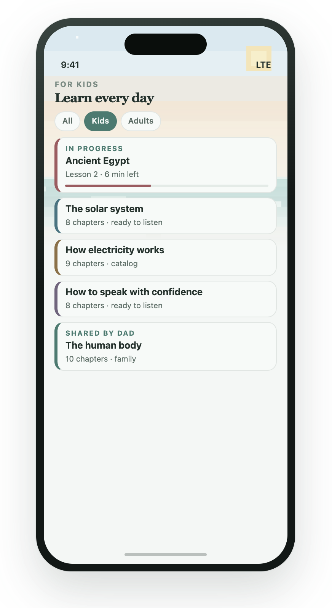

### Hi, I'm Gidi 👋

I build small, polished apps. Here are two:

---

### 🟩 [PeilTrail](https://github.com/Gidrono/PeilTrail)

A tiny macOS menu-bar app: hold **⌘** and move the mouse to paint a GitHub-style trail of pixel squares. Handy for pointing at things during screen shares and code reviews. It's also open-source!


```bash
brew install --cask gidrono/tap/peiltrail
```

---

### 🎧 [Qamishlo](https://qamishlo.org)

AI audio courses for curious kids and their parents. Pick any topic and get a multi-chapter course pitched to the listener's age. Pause mid-lesson to ask "why?" out loud.



<a href="https://play.google.com/store/apps/details?id=com.qamishlo.app.beta">
  
</a>
